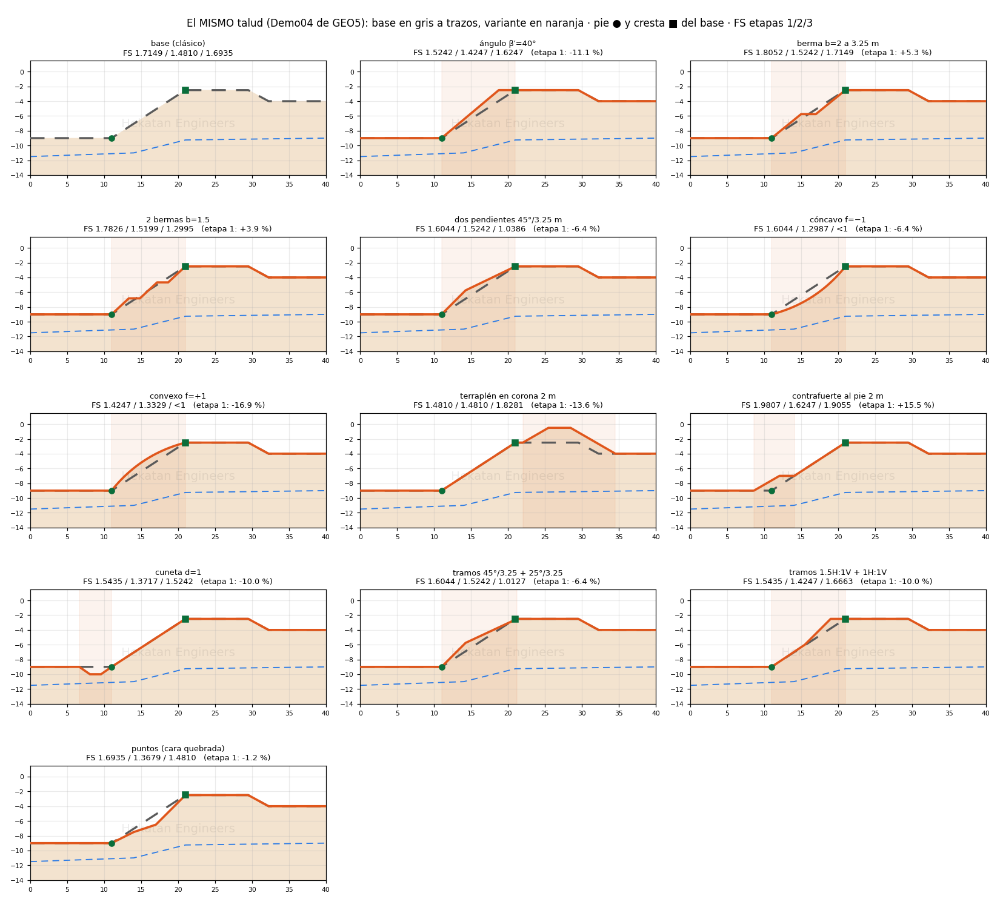
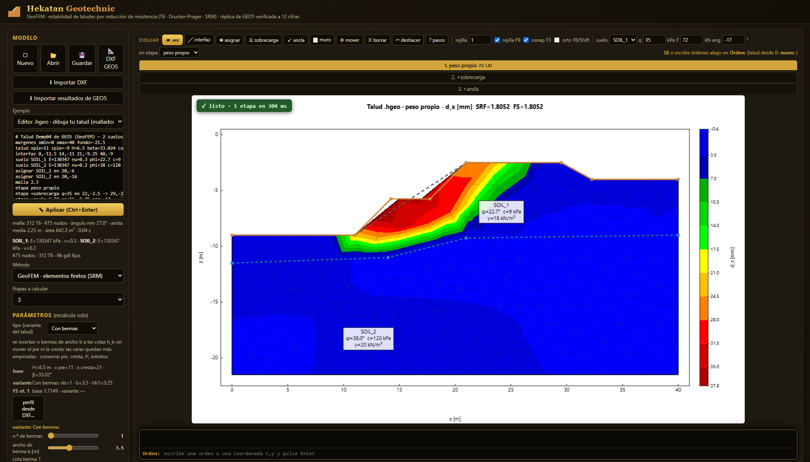
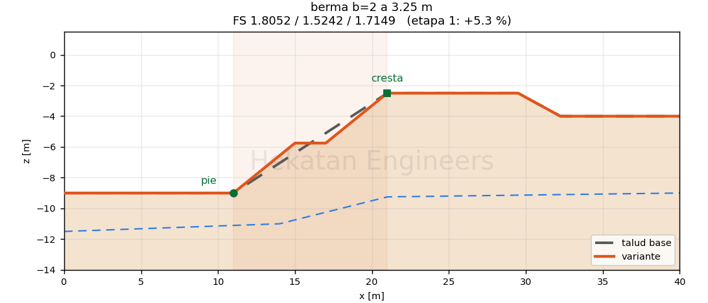
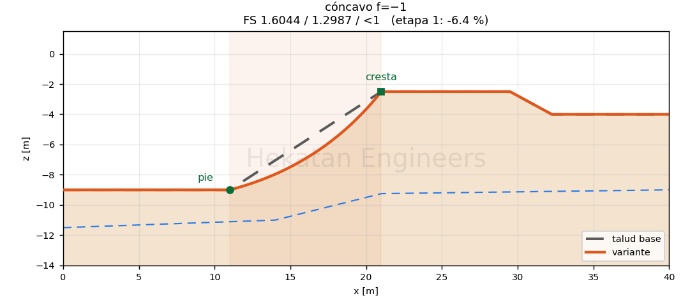
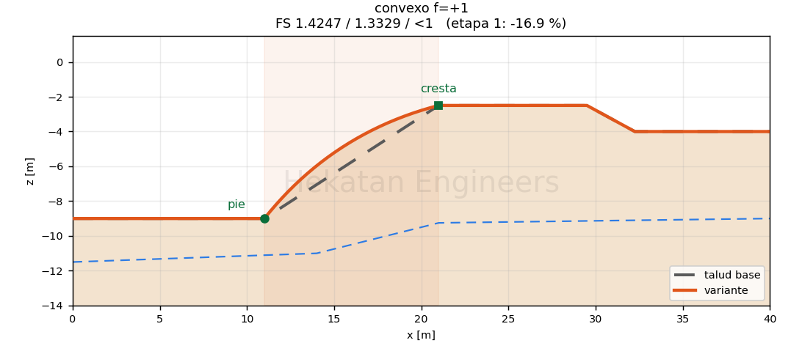
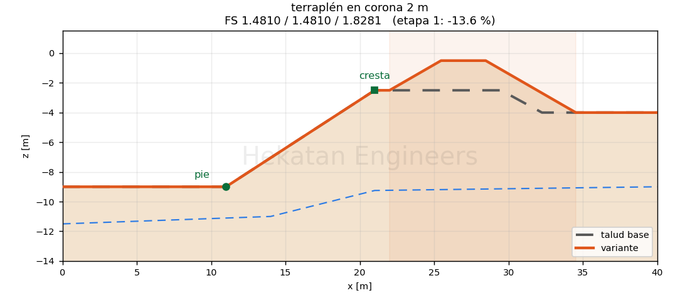
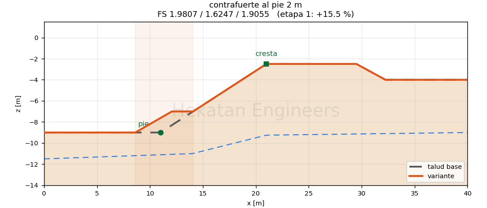
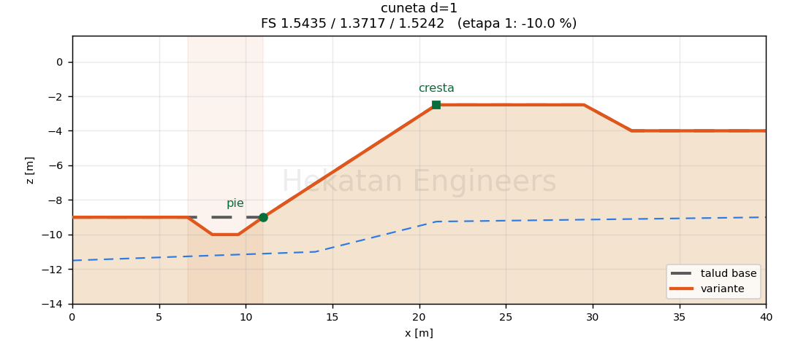
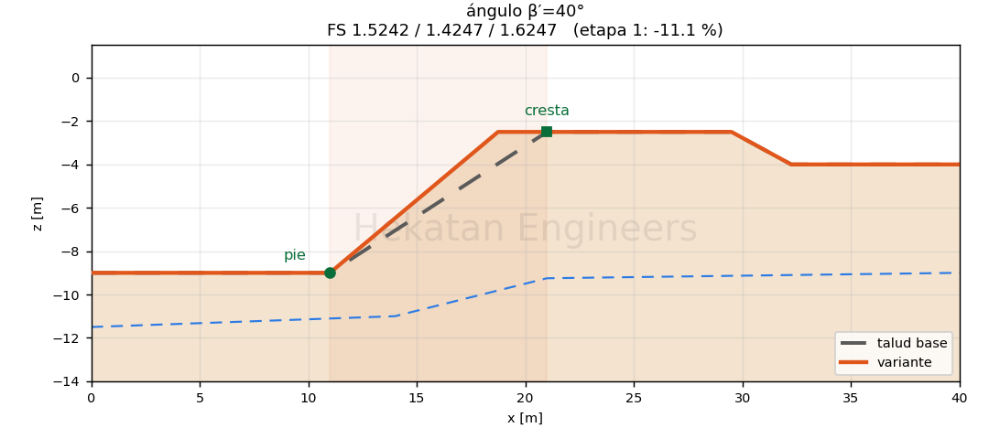
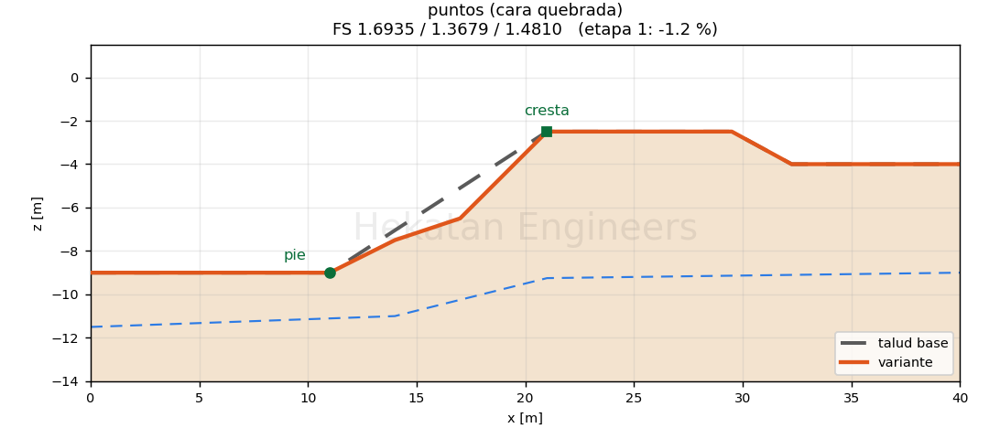

# Taludes parametrizados: un talud base y sus variantes

Hasta el 1-nov cada tipo (berma, dos pendientes, curvo…) dibujaba **otro** talud desde cero, así que el FS de un tipo no se podía
comparar con el de otro. Desde el 2-nov hay **un talud base** (el clásico de GEO5) y cada tipo es una **modificación de ese mismo
talud**. Se conservan la altura $H$, el pie, la cresta (cuando el tipo lo permite), los estratos, los suelos, la asignación por punto,
el agua, las cargas y los márgenes. La malla se rehace. Así se puede ver **cuánto cambia el FS del mismo talud**.



## El talud base

```
talud xpie=11 zpie=-9 H=6.5 beta=33.024 corona=8.5 zfin=-4 beta2=28.61
```

Pie $P=(x_p, z_p)$, cresta $C=(x_c, z_p+H)$ con $x_c = x_p + H\cot\beta$ (más las bermas clásicas, si las hay). La proyección
horizontal de la cara es $L = x_c - x_p$. Sin `tipo=` (o con `tipo=clasico`) el terreno es exactamente el de siempre
(`terrainFromParam`). **Demo04: FS = 1.7149 / 1.4810 / 1.6935, igual que antes del cambio.**

## Variantes: se añaden a la misma línea

```
talud <base> tipo=berma nb=1 b=2 hb1=3.25
```

Cada variante declara una **zona** $[x_0, x_1]$: fuera de ella el terreno es **exactamente** el del base (lo comprueba la prueba).

| tipo | parámetros | qué cambia (y por qué) | conserva |
|---|---|---|---|
| `angulo` | `betav` | la cara sale del mismo pie con otro ángulo $\beta'$; la cresta corre sobre la corona: $x_c' = x_p + H\cot\beta'$ | pie, $H$ |
| `berma` | `nb`, `b`, `hb1..3` | inserta `nb` bermas de ancho $b$ a las cotas $h_b$ **sin mover el pie ni la cresta**: las caras se empinan, $\Delta x/\Delta z = (L - n\,b)/H$ | pie, cresta, $H$ |
| `dos_pendientes` | `hq`, `beta1` | el mismo $H$ partido en dos: $\beta_1$ hasta $h_q$; el tramo de arriba sube recto a la cresta | pie, cresta, $H$ |
| `curvo` | `f` | parábola sobre la cuerda pie–cresta, desplazamiento normal $o(s) = 4 f\,s(1-s)$; $f>0$ convexa, $f<0$ cóncava | pie, cresta, $H$ |
| `terraplen` | `lado`, `Ht`, `bt`, `bf`, `dc` | relleno trapezoidal superpuesto con $\max(z_\text{base}, z_\text{relleno})$: en la corona (`lado=0`, a `dc` de la cresta) o al pie como contrafuerte (`lado=1`) | $H$ del corte; en la corona también el pie y la cresta |
| `cuneta` | `d`, `fondo`, `bz`, `sep` | cuneta trapezoidal excavada delante del pie con $\min(z_\text{base}, z_\text{cuneta})$ | pie, cresta, $H$ |
| `tramos` | `tr=ang/Δz;…` o `nh/Δz` | la cara se escribe tramo a tramo desde el pie (ángulo o pendiente $H{:}V = n{:}1$); lo que falte hasta $H$ cierra recto a la cresta | pie, $H$ |
| `puntos` | `pts=x,z;…` | perfil libre: tabla de puntos, arrastrar vértices con **mover** o **perfil desde DXF** | estratos, suelos, agua, cargas, márgenes |

El relleno del terraplén queda en la región de arriba (mismo suelo que la capa superior). Los puntos de **asignar** que la variante deja
fuera de su región (cuneta, cara más empinada) se mueven a la **misma región**: el mismo número de interfaces por encima, como en GEO5.
Las sobrecargas y anclas apoyadas en el terreno se apoyan en el terreno nuevo, en la misma $x$ (si el terreno ya no es recto bajo la
sobrecarga, sale un aviso).

## Cinco formas de dibujar el mismo talud

1. **Por ángulo y altura**: sliders del talud base ($H$, $\beta$, corona, contratalud, x del pie). Mueven el base y la variante lo sigue.
2. **Por parámetros de la variante**: sliders con **vista previa en vivo**: el base en gris a trazos (fantasma) y la variante en color.
   Una tabla muestra el base ($H$, x pie, x cresta, $\beta$), los parámetros de la variante y **FS base / variante / Δ %**.
3. **Por tramos**: `40/2` (ángulo 40°, sube 2 m) o `1.5h/3` (1.5H:1V, sube 3 m), uno por línea.
4. **Por puntos**: lista `x,z` editable o herramienta **mover**: al tocar un vértice del terreno el talud pasa a `tipo=puntos` **sin
   borrar el base** (antes se perdía la parametrización).
5. **Perfil desde DXF**: toma solo la capa del terreno (`TERRENO` u otra que el lector reconozca) y la pone como `tipo=puntos`; los
   estratos, suelos, agua y cargas del modelo se quedan. **Importar DXF** sigue reemplazando el modelo entero, como antes.




## FS del mismo talud (Demo04, malla 2.3, motor WASM)

Etapas: 1 peso propio · 2 +sobrecarga 35 kPa · 3 +ancla 72 kN. «<1» = falla ya con los parámetros reales.

| variante | FS 1 | FS 2 | FS 3 | Δ etapa 1 |
|---|---|---|---|---|
| **base (clásico)** | **1.7149** | **1.4810** | **1.6935** | — |
| ángulo β′ = 40° | 1.5242 | 1.4247 | 1.6247 | −11.1 % |
| berma b = 2 m a 3.25 m | 1.8052 | 1.5242 | 1.7149 | +5.3 % |
| 2 bermas b = 1.5 m | 1.7826 | 1.5199 | 1.2995 | +3.9 % |
| dos pendientes 45° hasta 3.25 m | 1.6044 | 1.5242 | 1.0386 | −6.4 % |
| cóncavo f = −1 m | 1.6044 | 1.2987 | <1 | −6.4 % |
| convexo f = +1 m | 1.4247 | 1.3329 | <1 | −16.9 % |
| terraplén en corona 2 m | 1.4810 | 1.4810 | 1.8281 | −13.6 % |
| contrafuerte al pie 2 m | 1.9807 | 1.6247 | 1.9055 | +15.5 % |
| cuneta d = 1 m | 1.5435 | 1.3717 | 1.5242 | −10.0 % |
| tramos 45°/3.25 + 25°/3.25 | 1.6044 | 1.5242 | 1.0127 | −6.4 % |
| tramos 1.5H:1V + 1H:1V | 1.5435 | 1.4247 | 1.6663 | −10.0 % |
| puntos (cara quebrada) | 1.6935 | 1.3679 | 1.4810 | −1.2 % |

Cómo se lee: la **etapa 1** es la comparación limpia (solo peso propio, mismo suelo y mismas capas). La berma y el contrafuerte suben
el FS; empinar la cara, la cuneta al pie y el relleno sobre la corona lo bajan; la cara convexa baja más que la cóncava. En la etapa 3
la cabeza del ancla (16, −5.75) se apoya en la cara nueva: si la cara se mueve, la carga puntual de 72 kN cae en otro sitio y puede
causar una falla local (por eso los «<1» y los 1.0x); en el terraplén la sobrecarga queda sobre un terreno que ya no es recto y carga
solo el tramo alineado.

## Pruebas

- `npx tsx tests/taludes_variantes.ts`: 13 casos. (a) conservan `param`, márgenes, estratos y pie/cresta donde el tipo lo dice;
  (b) FS del base = 1.7149 / 1.4810 / 1.6935; (c) fuera de la zona el terreno = base exacto; (d) ida y vuelta `.hgeo`;
  el formato v1 (`talud tipo=berma` sin `corona=`) se abre como terreno por puntos. Escribe `tests/out/variantes.json`.
- `node tests/check_tipos_talud.mjs http://127.0.0.1:<puerto>/`: puppeteer sobre la app (cada tipo del selector, sliders en vivo,
  arrastre de vértice, tramos, perfil DXF, .hgeo v1, cero errores de JS).
- `python tools/dibujar_variantes.py`: los PNG de este documento (`docs/img/variante_*.png`, `variantes_todas.png`).
- `npm test` sigue verde (Demo04 con la malla de GEO5, muro de Manabí, dinámicos, etapas TS = WASM).

## Dibujos

| | |
|---|---|
|  |  |
|  |  |
|  |  |
|  |  |
|  |  |
